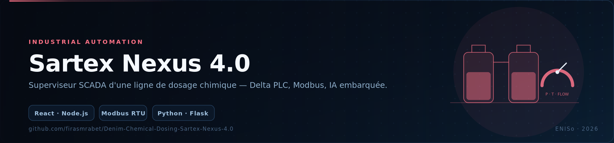
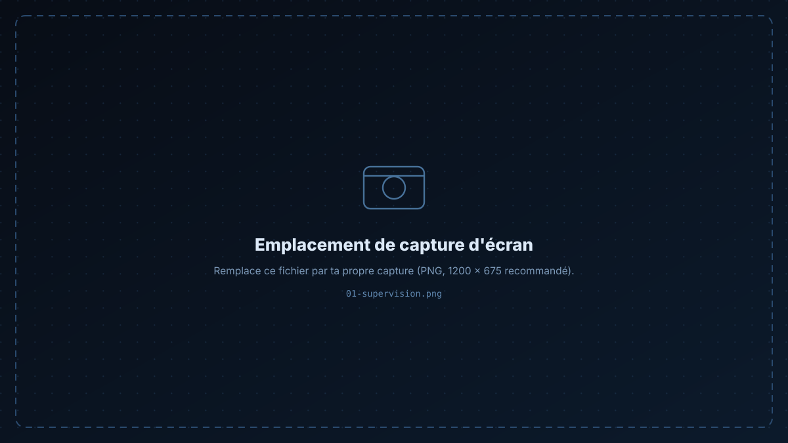
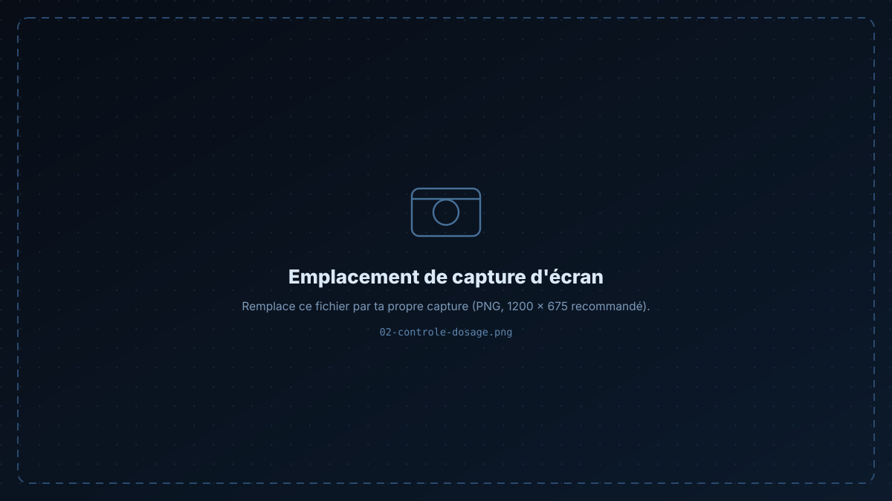

<p align="center">
  
</p>

<p align="center">
  
  
  
  
  
  
  
</p>

<h1 align="center">Sartex Nexus 4.0</h1>

<p align="center">
Superviseur <b>SCADA</b> d'une ligne de dosage chimique denim : niveaux de cuves, pressions, températures et états de vannes<br/>
en temps réel, contrôle manuel/automatique, et un moteur d'IA pour la détection d'anomalies et la maintenance prédictive.
</p>

<p align="center">
  <a href="#-fonctionnalités">Fonctionnalités</a> ·
  <a href="#-architecture">Architecture</a> ·
  <a href="#-démarrage">Démarrage</a> ·
  <a href="#-contexte-industriel">Contexte</a>
</p>

---

## 📸 Captures

<p align="center">
  
  
</p>

---

## ✨ Fonctionnalités

- **📈 Visualisation temps réel** — niveaux des cuves, pressions, températures et états des vannes, rafraîchis en continu.
- **🎛 Contrôle manuel / automatique** — interface d'administration pour ajuster les paramètres de dosage et reprendre la main sur l'automate.
- **🤖 Analyse intelligente** — détection d'anomalies (score Z), tendance de maintenance et optimisation des dosages via un moteur Python intégré.
- **🗂 Historique & rapports** — graphiques d'évolution et export des données pour l'analyse de performance.
- **🚨 Alarmes** — seuils et états défauts remontés dans l'interface de supervision.

---

## 🏗 Architecture

```
┌──────────────────────────────┐
│  Automate Delta DVP           │   Ladder / ISPSoft
│  + IHM tactile DOPSoft        │
└───────────────┬──────────────┘
                │ Modbus RTU (RS-485)
                ▼
┌──────────────────────────────┐
│  Passerelle Node.js           │   lecture des registres, horodatage
│  (server/)                    │   API + WebSockets vers l'interface
└───────────────┬──────────────┘
                │
      ┌─────────┴──────────┐
      ▼                    ▼
┌──────────────┐   ┌────────────────────┐
│ React + Vite │   │ Moteur IA Python   │
│ (src/, :5173)│   │ Z-score · tendance │
└──────────────┘   └────────────────────┘
```

### Structure

```
├── src/            # interface React (composants, pages, hooks)
├── server/         # passerelle Node.js + moteur IA Python
├── public/         # ressources statiques
├── components.json # configuration shadcn/ui
└── vite.config.ts
```

---

## 🚀 Démarrage

```bash
# 1 — dépendances front + serveur
npm install

# 2 — (optionnel) dépendances du moteur IA
cd server && pip install -r requirements.txt && cd ..

# 3 — lancer l'ensemble (client React + serveur Node + moteur Python)
npm run dev
```

L'interface s'ouvre sur **http://localhost:5173**.

> Sans automate physique, le serveur peut fonctionner en **mode simulation** : les valeurs de cuves, pressions et débits évoluent alors de façon réaliste pour permettre la démonstration complète de l'interface et du moteur d'anomalies.

---

## 🏭 Contexte industriel

Projet développé pendant un stage d'ingénierie chez **Sartex Group** (Ksar Hellal, Tunisie), dans le cadre de la modernisation des systèmes industriels du site : automatisation du dosage chimique sur **automate Delta DVP** (Ladder / ISPSoft) et **IHM DOPSoft**, supervision web temps réel et aide à la décision par analyse de données.

---

## 🛠 Stack

**Frontend** React · Vite · TypeScript · shadcn/ui · Recharts
**Backend** Node.js · Python (Flask) · WebSockets
**Industriel** Delta DVP · ISPSoft · DOPSoft · Modbus RTU

---

<div align="center">

**Firas Mrabet** — Élève ingénieur en informatique appliquée @ ENISo

[GitHub](https://github.com/firasmrabet) · [LinkedIn](https://www.linkedin.com/in/firas-mrabet-98779934b) · [Portfolio](https://firas-mrabet-portfoliowebsite.vercel.app) · [Email](mailto:firasmrabet1603@gmail.com)

</div>
